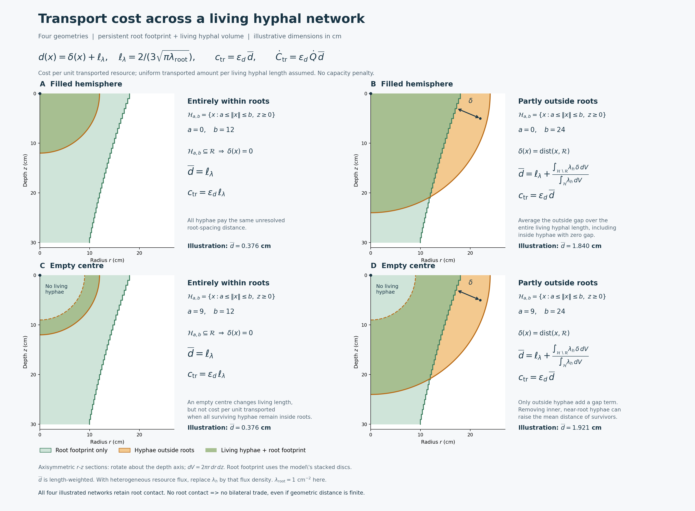

# Distance-based hyphal transport costs in four geometries

27 October 2026. Mathematical derivation and illustrative scientific figure.
This is a proposed cost closure, not a production implementation or an empirical
calibration. Scope is distance to the nearest root across the living hyphal
network. Stem transport, transport capacity and spatial policy control are
outside this derivation.

Exports: [PDF](transport-shell-costs.pdf), [SVG](transport-shell-costs.svg).
[Generator](generate.py); [numerical checks](verification.json).

## Updated two-panel growth-transport figure

The [new two-panel figure](growth-transport-figure.md) illustrates the selected
carbon-delivery-to-new-growth scope, including contained and beyond-root
fronts. The original four-panel figure above is retained as historical
whole-network/P-stream exploration.

## Plant growth-front-to-stem figure

The [single-panel plant figure](plant-growth-transport-figure.md) applies the
same construction-carbon cost form to new fine-root annuli, using an explicit
straight-line distance proxy to the central stem base. It includes the
root-disc depth distribution and a symbolic, unfitted plant coefficient.

## Current decision: growth-shell carbon transport; free polyphosphate transport

**Accepted scope, 11 November 2026; not implemented.** Set the explicit fungal
polyphosphate-translocation carbon-cost coefficient to zero. Uptake, P transfer,
structural P requirements and P accounting continue unchanged. This is an
energetic approximation, not a claim that polyphosphate formation, membrane
uptake, exchange or real biological translocation has no energetic requirements.
It adds no new P sink, uptake restriction or transport-capacity limit.

Under the intended oldest-first maintenance-mortality rule, retain the outer
front while the organism remains operational: loss is allocated to older tissue
rather than implemented as front retraction. Explicitly remove the previous
provisional outer-retreat fallback from the revised plan. Age ordering alone
is not a universal guarantee of a non-retracting front; this is the selected
spatial rule. Any positive-floor rule that prevents the prescribed loss must
be reconciled with it rather than silently restoring retreat or forgiving mass
loss. Organism death/absence still disables active geometry and exchange.

For the remaining proposed carbon-delivery-to-growth cost, use

\[
w_t=R_{t+\Delta t}-R_t\geq0,\qquad
\mathcal A_t=\{x:z\geq0,\ R_t\leq\|x\|\leq R_{t+\Delta t}\}.
\]

Mortality leaves the surviving outer front at `R_t`, so there is no separate
retreat correction. Its interior cavity and living-length profile can still
change. The new-length-weighted root distance remains

\[
\bar d_t=\ell_\lambda+
\frac{\int_{\mathcal A_t}\lambda_{\rm new}\delta\,dV}
{\int_{\mathcal A_t}\lambda_{\rm new}\,dV}.
\]

Multiply this distance by the realised carbon delivery for construction and
a separately designed carbon-transport coefficient. Shell volume is not an
additional multiplier on a transported amount already specified by the budget.
The selected first closure (17 November 2026) is
`Cdot_transport = b * F_C * mean_route_distance`, with constant effective transport
velocity across routes, time and delivery rates. Its effect is absorbed into
`b` [cm^-1]; velocity and travel delay are not resolved. Constant incremental
expenditure per unit carbon per unit distance is an additional assumption,
not a consequence of constant velocity alone. The coefficient, precise delivery
basis, cost transaction and coupling to funded growth remain to be specified;
no numerical velocity or coefficient is chosen here. Keep demand/distance
construction, the replaceable energetic law and resource-budget accounting
separate, as recorded in [ADR-0021](../../adr/0021-treat-internal-transport-capacity-as-non-limiting.md).

With zero growth, the construction stream and its construction-related
transport charge are zero. Do not evaluate the empty-shell ratio. P uptake and
trade may continue without a new polyphosphate-transport charge, so the formerly
open P-distance fallback is unnecessary. Ordinary maintenance continues; this
does not remove standing respiration or decide an additional maintenance-C
transport model. Loss of root contact still disables bilateral exchange even
though P translocation is assigned zero energetic cost.

The growth-shell width shrinks under timestep refinement, as a numerical
increment of new tissue rather than a fixed biological active-zone width.
Its normalised distance has a front-surface limit under smooth resolved
conditions; qualify cumulative costs over matched physical time. FWHM and
Edelstein/BARE morphology remain deferred. Earlier whole-network/P-transport
formulas and the four-case figure below are retained as alternatives considered,
not an active nonzero P-cost specification.

## Earlier decision: parameterised physical width (replaced as the current proposal)

**Accepted, 28 October 2026; not implemented.** Use a configurable physical
width `w` in cm for the transport-demand proxy, provisionally named
`transport_front_width_cm`. Require finite `w>0`; no numerical default has been
selected. Uptake and the prescribed outer-boundary tissue-growth rule remain
unchanged. Uptake-FWHM estimation and evolving Edelstein/BARE tip fields are
deferred alternatives, not requirements of this version.

For outer front radius `b` and any empty-centre radius `a`, use

\[
\mathcal A_w=\mathcal H_{a,b}\cap
\{x:\max(a,b-w,0)\leq\|x\|\leq b\},
\qquad
\bar d_{\rm front}=\ell_\lambda+
\frac{\int_{\mathcal A_w}\lambda_h\delta\,dV}
{\int_{\mathcal A_w}\lambda_h\,dV}.
\]

The shell includes only living tissue. When the surviving network is thinner
than `w`, use all of it. Width is independent of numerical timestep, soil-cell
spacing and the thickness of the newest growth cohort. The shell approximates
transport source/destination distances; it does not add new tissue throughout
the band, turn off interior uptake or remove interior maintenance obligations.
If no living shell remains, its mean is undefined and associated realised
transport is zero; it must not generate a finite cost from an arbitrary epsilon
in the denominator. The existing contact-loss exchange gate still applies.

This preserves the current growth-budget and cohort approach while permitting
width sensitivity analysis. A width is a model parameter, not a measured front
thickness or an emergent prediction. Resource-specific cost coefficients,
transported amounts, cost ownership and update timing still need design.
Sections7–8 below preserve the alternatives considered; the four-case figure
continues to show the earlier whole-network weighting, not this shell decision.

## 1. Geometry and what “incomplete” means here

The user confirmed that the two rows mean a filled hemisphere versus a hollow
hemisphere with an empty centre, not missing angular sectors. Write

\[
\mathcal H_{a,b}=\{(r,\varphi,z):z\geq0,\ a\leq\sqrt{r^2+z^2}\leq b\}.
\]

A filled hemisphere has `a=0`; a hollow one has `0<a<b`. The living hyphal
length density is `lambda_h(x)` [cm hypha/cm³ soil]. A hollow interior has zero
living hyphal density and contributes neither length nor transported source
weight. A partially depleted surviving cohort can have reduced density, in
which case retain that density in the integrals below.

Let `R` (calligraphic in equations) be the **persistent root-containing
footprint**, not the surviving fine-root uptake field. Its cells remain
exchange-available while the plant is operational, under
[ADR-0022](../../adr/0022-separate-fine-root-mortality-from-persistent-backbone-connectivity.md).
The reference fine-root density parameter is used provisionally for unresolved
root spacing; it is not allowed to vanish when local fine roots die.

For the existing stack of discs, a continuous occupied-region representation is

\[
\mathcal R=\bigcup_k\{(r,\varphi,z):0\leq r\leq R_k,\ z_k\leq z\leq z_{k+1}\}.
\]

Here `R_k` belongs to the persistent footprint. Current biomass-derived
[production radii](../../../src/mycormarl/plant/roots.py) do not themselves
implement that historical persistence. For a point `(r,z)`, the exact distance
to this union of finite-thickness discs is

\[
\delta(r,z)=\min_k\sqrt{[r-R_k]_+^2+
\operatorname{dist}(z,[z_k,z_{k+1}])^2},
\qquad [u]_+=\max(u,0).
\]

Axisymmetry makes the nearest azimuth equal to the source azimuth. The
nearest disc need not be in the same depth layer: horizontal distance alone
can overestimate the nearest-root-footprint distance.

For the requested **nearest root-containing cell** version, choose cell centres
`x_i=(r_i,z_i)` and use

\[
\delta_i=\min_{j\in\mathcal J_R}\|x_i-x_j\|_2,
\]

where `J_R` contains occupied persistent root cells. Same-cell distance is
zero. This defines one concrete grid approximation; distances to cell volumes
are a different discretisation. The figure and its quadrature use the exact
stacked-disc union as a continuum reference, rather than claiming that a grid
choice has already been implemented. Partial front occupancy and cell-centre
sampling need refinement checks.

## 2. Unresolved distance from the root footprint to an individual root

Use the agreed existing reference `lambda_root` [cm root/cm³ soil = cm⁻²].
For an illustrative circular-territory closure, assign each straight root a
territory radius

\[
R_T=(\pi\lambda_{\rm root})^{-1/2}.
\]

A uniformly chosen point in that cross-sectional disc has radial probability
density `p(rho)=2*rho/R_T²`. Thus its mean distance to the root axis is

\[
\ell_\lambda
=\int_0^{R_T}\rho\,\frac{2\rho}{R_T^2}\,d\rho
=\frac{2R_T}{3}
=\frac{2}{3\sqrt{\pi\lambda_{\rm root}}}.
\]

The coefficient `2/(3*sqrt(pi))` follows from this **particular statistical
geometry**, not from a measured universal nearest-root law. This neglects
root radius and network tortuosity. A different point/line distribution or
root-surface definition changes the coefficient. At the current reference
`lambda_root=1 cm⁻²`, this closure gives `ell_lambda=0.3761 cm`.

The local distance proxy is

\[
\boxed{d(x)=\delta(x)+\ell_\lambda.}
\]

The density term represents unresolved spacing in the root-containing region;
it is not literally a distance bounded by the numerical cell width. For
example, 0.3761 cm exceeds the 0.05 cm production cell width. Our root footprint
is a coarse statistical occupied region, not a claim that an individual root
passes through every tiny cell. Additivity is the requested phenomenological
closure and must not be described as an exact shortest path to a resolved root.

## 3. Network mean and conversion to transport cost

Total living hyphal length and its length-weighted mean root distance are

\[
L_h=\int_{\mathcal H}\lambda_h(x)\,dV,
\qquad
\boxed{\bar d_L=\frac{\int_{\mathcal H}\lambda_h(x)d(x)\,dV}{L_h}.}
\]

Here `dV=2*pi*r dr dz` in the meridional grid. A simple arithmetic mean of r-z
pixels overweights the central region. The corresponding discrete approximation is

\[
\bar d_L=\ell_\lambda+
\frac{\sum_i L_{h,i}\delta_i}{\sum_i L_{h,i}},
\qquad L_{h,i}=\lambda_{h,i}^{\rm cell}\,V_i.
\]

The density is cell-volume averaged here so occupied fractions are included
once. Do not multiply by the occupied fraction a second time.

To turn distance into carbon expenditure, hypothesise an energetic coefficient
`epsilon_d` [g C/(mg P cm)] for a specified transported P stream. If each unit
of living hyphal length contributes the same transported amount, then

\[
\boxed{c_{\rm tr}=\epsilon_d\bar d_L}
\quad[\mathrm{g\ C\ mg^{-1}\ P}],
\qquad
\boxed{\dot C_{\rm tr}=\epsilon_d\dot Q_P\bar d_L}
\quad[\mathrm{g\ C\ day^{-1}}].
\]

`Qdot_P` is realised P transported per day, not a growth rate, requested trade,
or automatically all soil uptake. Its source allocation is part of a future
energetic implementation; fungal uptake retained for its own growth is not
necessarily rootward host delivery. No value for `epsilon_d` is selected.
There is no distance-independent cost added in this figure.

If actual transported P source density is `j_P(x)` [mg P/cm³/day], use the
exact linear-price expression instead:

\[
\dot C_{\rm tr}=\epsilon_d\int_{\mathcal H}j_P(x)d(x)\,dV,
\quad
\bar d_P=\frac{\int j_Pd\,dV}{\int j_P\,dV}.
\]

The length mean equals this flux mean only if `j_P` is proportional to
`lambda_h`. This is the figure's declared comparison assumption. Zero
transported P means zero P-transport expenditure; a zero-length network has
no defined mean distance. These formulas do not price tipward C transport.

## 4. The requested two-by-two comparison

Define the length-weighted **outside gap**

\[
E_{a,b}=\frac{\int_{\mathcal H_{a,b}\setminus\mathcal R}
\lambda_h(x)\delta(x)\,dV}
{\int_{\mathcal H_{a,b}}\lambda_h(x)\,dV}.
\]

| Geometry | Mean distance | Carbon cost per unit P under the stated source assumption |
|---|---|---|
| A. Filled, entirely within roots | `dbar=ell_lambda` | `c_tr=epsilon_d*ell_lambda` |
| B. Filled, partly outside roots | `dbar=ell_lambda+E_(0,b)` | `c_tr=epsilon_d*(ell_lambda+E_(0,b))` |
| C. Hollow, entirely within roots | `dbar=ell_lambda` | `c_tr=epsilon_d*ell_lambda` |
| D. Hollow, partly outside roots | `dbar=ell_lambda+E_(a,b)` | `c_tr=epsilon_d*(ell_lambda+E_(a,b))` |

In B and D the denominator includes **all living hyphae**, including those
inside the root footprint with zero outside gap. Dividing only by outside
length would overestimate the network-average distance.

An empty centre does not automatically add a cost to every remaining hypha.
When all survivors remain inside the root footprint, per-unit transport cost
is unchanged. Where the removed inner region was inside roots and outer
hyphae remain outside, the remaining network has a larger outside fraction
and hence a larger mean distance. This comparison fixes the outer radius,
not total biomass or realised transported P. Total respiration can fall even
while cost per unit delivered increases.

For constant density, when the entire removed inner hemisphere lies in roots,

\[
E_{a,b}=\frac{b^3}{b^3-a^3}\,E_{0,b}.
\]

This identity holds for any root shape with that containment property. If the
removed region also contains outside hyphae, it no longer holds and the
integrals determine whether the mean increases or decreases.

## 5. Closed forms for a concentric reference geometry

For an analytically solvable special case only, replace the stacked-disc root
footprint by a concentric root hemisphere of radius `R`. Do not mistake this
for the production root geometry. Then `delta(s)=[s-R]_+`,
`dV=2*pi*s² ds`, and constant-density shells give

\[
\bar d_L=\ell_\lambda+
\frac{3}{b^3-a^3}\int_a^b s^2[s-R]_+\,ds.
\]

The four cases reduce to

\[
\begin{array}{lll}
\text{A:}&a=0,\ b\le R,&\bar d_L=\ell_\lambda,\\[3pt]
\text{B:}&a=0,\ b>R,&\bar d_L=\ell_\lambda+
\frac{3b^4-4Rb^3+R^4}{4b^3},\\[5pt]
\text{C:}&0<a<b\le R,&\bar d_L=\ell_\lambda,\\[3pt]
\text{D:}&0<a<R<b,&\bar d_L=\ell_\lambda+
\frac{3b^4-4Rb^3+R^4}{4(b^3-a^3)}.
\end{array}
\]

Multiply each mean by `epsilon_d` for cost per unit P or by
`epsilon_d*Qdot_P` for daily cost under uniform transported source per length.

If `R<a<b`, a definite empty gap separates all living hyphae from roots.
A finite geometric mean can still be calculated:

\[
\bar d_L=\ell_\lambda+
\frac{3(b^4-a^4)}{4(b^3-a^3)}-R.
\]

But it is **not an executable host-exchange cost**: under the accepted
contact-loss rule there is no bilateral trade, so its realised host-P stream
and associated host-P transport cost are zero. At exact boundary-only contact
`a=R`, the implementation must specify how contact is detected; positive
occupied overlap and touching closed boundaries are different conventions.

## 6. Illustration and verification

The figure uses the actual *form* of the stacked-disc geometry: 30 one-cm
layers, beta=0.96 and first-layer radius 18 cm. These are illustrative dimensions,
not a fitted plant biomass. Filled cases have `a=0`; hollow cases `a=9 cm`.
Contained cases have `b=12 cm`; partly outside cases `b=24 cm`. The same root
footprint and reference density are used throughout. All four retain root
contact; a hollow shell need not imply contact loss.

The generator performs midpoint quadrature in `(s,mu)` with `mu=cos(theta)`
and weights `s²`, compares 320×320 against 640×640, verifies contained-case zero
gaps and the inner-ball removal identity, and independently checks the
concentric closed forms against dense one-dimensional quadrature. Actual
results are in verification.json. These are mathematical checks of the figure,
not biological qualification or production transport tests.

The derivation refines the research discussion; it does not choose a calibrated
energetic coefficient, change the action space, decide the unresolved fungal
mortality geometry, or supersede the non-limiting capacity decision in ADR-0021.

## 7. Proposed active-front weighting (discussion, 28 October 2026)

The user proposed replacing whole-living-network source weighting by a thin
active shell near the outer front. This is not yet an accepted restriction on
production uptake. For front width `w` [cm], define

\[
\mathcal A_w=\mathcal H_{a,b}\cap\{x:b-w\leq\|x\|\leq b\},
\qquad s_0=\max(a,b-w,0).
\]

The geometric front-source approximation is

\[
\bar d_{\rm front}
=\ell_\lambda+
\frac{\int_{\mathcal A_w}\lambda_h\delta\,dV}
{\int_{\mathcal A_w}\lambda_h\,dV}.
\]

For constant density this is the previous shell formula with inner radius
`s_0`, rather than the mortality-cavity radius `a`. Consequently a central void
inside the active shell's inner boundary has no direct effect on this mean,
although it can affect maintenance, contact and total resource flux. If the
remaining living shell is thinner than `w`, all surviving tissue is included.
The zero-width limit is a surface average, not a zero-over-zero volume formula.

For the concentric root reference, a thin outer shell approaches
`ell_lambda + max(b-R,0)`. With the actual stacked-disc footprint the surface
average still varies with angle; do not substitute a single root radius.

Carbon supply for growth and P return have different source/destination
weights. A consistent linear-price expression is

\[
\dot C_{\rm tr,P}=\epsilon_P\int j_P(x)d(x)\,dV,
\qquad
\dot C_{\rm tr,C}=\epsilon_C\int j_C(x)d(x)\,dV.
\]

Here `j_P` is the explicitly selected rootward P source density
[mg P/cm³/day], and `j_C` is tipward C delivery demand [g C/cm³/day].
`epsilon_P` has g C/(mg P cm), while `epsilon_C` has g C/(g C delivered cm).
A shared front mask for both is an additional approximation, not a consequence
of bidirectional transport. Interior maintenance C supply is outside a
front-growth-only charge and must not silently be assumed absent.

Primary root-organ-culture evidence describes a pulse of growing tips followed
by absorbing mycelium and a propagating P-depletion pattern, including continued
investment in branched absorbing structures behind tips. It motivates testing
a finite active zone but does not establish zero uptake everywhere behind a
fixed-width front. [Oyarte Galvez et al. (2025)](https://doi.org/10.1038/s41586-025-08614-x).

Recommendation under discussion: retain the production uptake closure, use its
realised spatial uptake as an initial proxy for P transport-source weights,
and measure what fraction lies within each candidate physical front width.
Rootward transported P is not automatically identical to uptake retained by
the fungus. Growth-related C demand is already assigned to front growth by the
planned geometry. Only after that diagnostic should a fixed shell replace the
P weighting. A front-only uptake mask would instead change the biological model
and revise the agreement that surviving interior tissue remains uptake-active.
The shell width must not equal the newest numerical-step growth increment,
which would make biology depend on timestep. No width or energetic coefficient
is selected, and the four-case figure retains its original whole-network
weighting for comparison.

## 8. Uptake-informed FWHM width (deferred alternative, 28 October 2026)

The user confirmed that uptake must continue unchanged. They propose using the
full width at half maximum (FWHM) of an uptake peak behind the advancing front
as a proxy for dispersion of the growth/transport-demand zone. This is a
transport-geometry diagnostic, not a mask on soil uptake and not a change to
front-only tissue construction.

A recommended profile is accepted P uptake per unit living hyphal length in
physical radial bins about the colony origin:

\[
u_k(t)=\frac{\Delta P_{h,k}^{\rm accepted}}
{\Delta t\,L_{h,k}},
\qquad s=\sqrt{r^2+z^2}.
\]

Empty bins have no defined per-length rate and must not supply artificial
profile points. Divide by the current physical duration, and accumulate
accepted P over all soil substeps. Normalising by length removes the trivial
outward increase in hemispherical bin area and avoids mistaking more hyphae
for a higher activity rate. This profile choice is a recommendation; using
uptake per occupied bulk volume or total uptake per radial interval yields a
different FWHM and should not be conflated with it.

For a positive, isolated advancing-front peak at `s_p`, let `u_max=u(s_p)` and
find its two neighbouring half-height crossings:

\[
u(s_-)=u(s_+)=\tfrac12u_{\max},\qquad
s_-<s_p<s_+,\qquad
w_{\rm FWHM}=s_+-s_-.
\]

Select the contiguous above-half-height lobe containing that front peak,
rather than joining disjoint nutrient-patch peaks into one width. Interpolate
crossings between bins and qualify physical-bin/grid/time refinement. A
Gaussian fit is not required; a Gaussian profile would give the familiar
`w=2*sqrt(2*ln(2))*sigma` only as a special case.

Two distinct transport proxies are possible:

- Actual uptake-peak band: `H intersect {s_- <= s <= s_+}`. This preserves both
  measured location and width, but may exclude the growing tips near `b`.
- Dispersed-growth-front proxy (recommended interpretation of the proposal):
  borrow the width and anchor it at the outer growth front,
  `A_FWHM=H intersect {max(a,b-w_FWHM,0) <= s <= b}`. This deliberately shifts
  the peak-derived width; it does not assert that this shell exactly contains
  the uptake peak.

If instead the shell must contain both the half-height band and the outer tip,
its width is `b-s_-`, which equals the FWHM plus the gap `b-s_+`. Call that a
front-to-half-height width rather than FWHM.

The transport-distance average in section7 can use the selected shell, with
`d(x)=delta(x)+ell_lambda` and living-length weights (or a separately declared
demand profile). Uptake outside the shell remains realised and credited by the
existing uptake transaction. Applying the shell-derived mean to all rootward
P transfer is an aggregate cost approximation; it does not make interior P
transport absent, and it is not the exact source-weighted price for those
interior uptake contributions. The proxy is particularly natural for tipward
growth C demand; interior maintenance supply still needs its separate scope.

There need not be a valid FWHM: fresh uniform soil can produce a broad profile,
zero P produces no uptake, patchiness can create several peaks, and a profile
truncated at the front/domain boundary may have only one half-height crossing.
Growth can continue from retained P even when current uptake is zero. Do not
silently define zero width or zero growth-transport cost in those cases.
A fallback remains to be agreed; reverting to the earlier whole-network mean
is one parameter-free option. No FWHM algorithm, width fallback or revised
figure has been implemented by this discussion.
