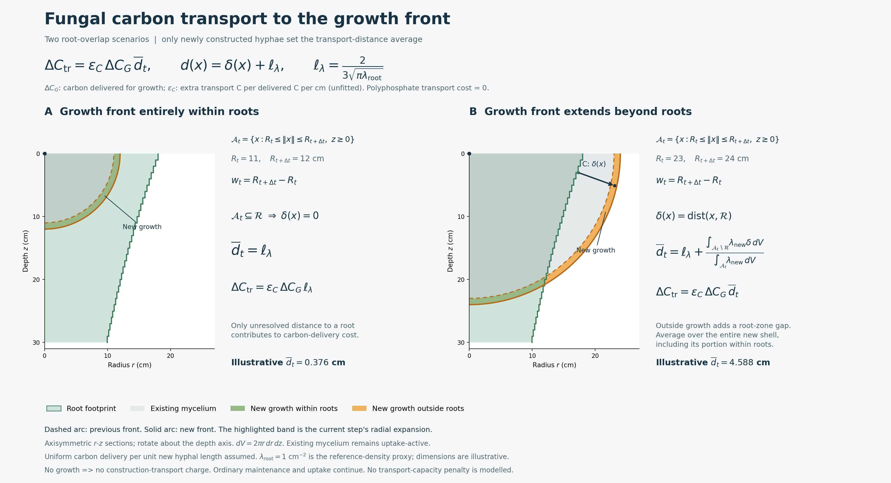

# Fungal carbon transport to the current growth shell

Two-panel scientific illustration, 11 November 2026. This is a geometric cost
proposal, not a calibrated or implemented physiological model. It follows the
current decision to charge only the proposed carbon delivery to new growth,
with zero explicit polyphosphate-translocation cost.

Exports: [PDF](fungal-growth-transport-costs.pdf),
[SVG](fungal-growth-transport-costs.svg).
[Reproducible generator](generate_growth_transport.py);
[mathematical checks](growth-transport-verification.json).

## Shared interpretation

The green outline is the persistent root-containing footprint, represented by
the model's stack of depth-dependent discs. The dashed fungal arc is the
previous outer front `R_t`; the solid arc is the post-growth front
`R_(t+dt)`. Only the newly constructed external hyphae in the intervening band
supply the distance weights. Existing mycelium remains uptake-active and
maintenance-paying. An interior mortality cavity is omitted from the drawings
because it does not change this newly deposited band under the accepted
non-retracting-front approximation. Both drawings retain root contact.

For new external growth `A_t`, root footprint `R`, and reference root density,

\[
\mathcal A_t=\{x:z\geq0,\ R_t\leq\|x\|\leq R_{t+\Delta t}\},
\quad w_t=R_{t+\Delta t}-R_t,
\quad d(x)=\delta(x)+\ell_\lambda,
\quad \ell_\lambda=\frac{2}{3\sqrt{\pi\lambda_{\rm root}}}.
\]

The spacing coefficient follows the earlier circular-territory approximation;
it is not an independent measurement of coarse-root spacing. For the continuum
illustration, `delta=dist(x,R)` is the exact nearest distance to the union of
finite-thickness root discs. Distance to the nearest root-containing numerical
cell is a discretisation of that proxy, not literally the resolved shortest
path to an individual root. The arrow in panel B points outward from a nearest
root-footprint location to a sample location in the new growth band.

Assuming carbon delivery is uniform per unit newly constructed hyphal length,

\[
\bar d_t=\ell_\lambda+
\frac{\int_{\mathcal A_t\setminus\mathcal R}
\lambda_{\rm new}(x)\delta(x)\,dV}
{\int_{\mathcal A_t}\lambda_{\rm new}(x)\,dV},
\qquad
\Delta C_{\rm tr}=\epsilon_C\,\Delta C_G\,\bar d_t.
\]

`Delta C_G` is carbon delivered for construction of the new external shell,
not all fungal C received in trade. With the static IRM allocation it excludes
carbon allocated to new IRM, and it also excludes maintenance and reproductive
exports. `epsilon_C` has g C spent/(g C delivered cm), or cm⁻¹; no value is
selected. The equation defines an additional transport expenditure, not a
second charge of the delivered construction carbon itself. Actual implementation
must fund both consistently; this figure does not decide that transaction.

## Panels

**A — Growth front entirely within roots.** All new tissue is within the root
footprint, so `delta=0` and `Delta C_tr=epsilon_C*Delta C_G*ell_lambda`. The
reference-density spacing term remains positive even with perfect envelope
overlap.

**B — Growth front extends beyond roots.** Some new tissue has a positive gap
to the root footprint. The denominator includes the **entire** new growth shell,
including the part still inside roots. This raises mean delivery distance
relative to A without introducing any transport-capacity penalty.

The same root footprint appears in both panels: beta=0.96, 30 one-cm layers,
first-layer radius 18 cm. Panel A grows from radius 11 to 12 cm; B from 23 to
24 cm. These illustrative one-cm increments are chosen for visibility, not
claimed as a production numerical step's typical expansion. The panels have
different constructed volumes and are not equal-biomass or equal-growth
experiments. Their displayed mean distances compare the **distance multiplier**,
not absolute carbon expenditure. Reference density is 1 cm root/cm³ soil.

## Verification

The generator integrates in hemispherical coordinates using
`dV=2*pi*s² ds dmu`, `mu=cos(theta)`, with exact distance to the disc union at
each quadrature point. It compares 320×320 and 640×640 quadrature, checks zero
envelope gap in A and mixed inside/outside occupancy in B, and independently
checks mean radial position against its closed form. Numeric results are in
the linked JSON. PNG and rendered PDF are visually checked before delivery.

Zero growth produces no new-shell construction charge; the empty-shell ratio
must not be evaluated. Ordinary uptake and maintenance continue. P transport
has no extra energetic debit under the current approximation. No contact with
roots still disables bilateral trade; zero energetic cost does not restore a
missing connection. None of these drawings adds an action dimension or changes
production code.
