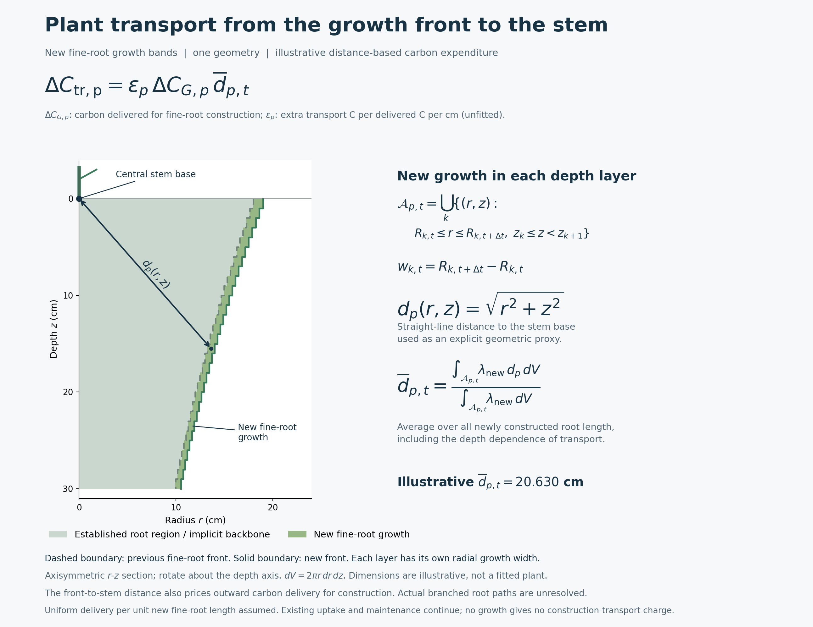

# Plant transport from fine-root growth fronts to the central stem

Single-panel scientific illustration, 12 November 2026. This is an illustrative
extension of the fungal construction-transport figure, with a symbolic,
unfitted plant cost coefficient. It is not a production implementation or a
claim to resolve vascular routes.

Exports: [PDF](plant-growth-transport-costs.pdf),
[SVG](plant-growth-transport-costs.svg).
[Generator](generate_plant_growth_transport.py);
[numerical checks](plant-growth-transport-verification.json).

## Geometry and distance

The plant uses stacked root discs, not a hemisphere. Each soil depth layer has
its own initial and final radial extent. Newly constructed fine roots occupy
annular bands

\[
\mathcal A_{p,t}=\bigcup_k\{(r,\varphi,z):
R_{k,t}\leq r\leq R_{k,t+\Delta t},\quad z_k\leq z<z_{k+1}\},
\qquad w_{k,t}=R_{k,t+\Delta t}-R_{k,t}.
\]

The target is the stem base/root collar at `(r,z)=(0,0)`. The figure explicitly
chooses a straight-line first approximation

\[
d_p(r,z)=\sqrt{r^2+z^2}.
\]

The dimension arrow shows front-to-stem distance, not inward carbon flow.
Construction carbon travels outward; the same geometric distance is used to
price it. Actual branching, tortuosity and a vertical-then-lateral route are
not resolved. A route such as `r+z`, or a tortuosity factor, would be a different
cost-geometry assumption and change the displayed mean. This illustration
does not select that physiological detail for a production model.

There is no nearest-root spacing correction: the growth sites are roots
already, and the endpoint here is the stem base rather than an unresolved
nearby root. There is no aboveground stem length in this distance.

## Cost formulation

Assuming equal carbon delivery per unit new fine-root length,

\[
\bar d_{p,t}=
\frac{\int_{\mathcal A_{p,t}}\lambda_{\rm new}(x)d_p(x)\,dV}
{\int_{\mathcal A_{p,t}}\lambda_{\rm new}(x)\,dV},
\qquad dV=2\pi r\,dr\,dz,
\]

\[
\Delta C_{\rm tr,p}=\epsilon_p\,\Delta C_{G,p}\,\bar d_{p,t}.
\]

`Delta C_G,p` is carbon delivered for **fine-root** construction, not all
whole-plant growth or all plant-to-fungus trade. `epsilon_p` is extra carbon
expenditure per delivered carbon per cm, in cm⁻¹; its value remains unset.
The delivered construction carbon itself must not be charged twice. Funding
this extra cost is still an implementation-design task. Zero construction
means zero construction-related transport charge; ordinary uptake and
maintenance continue.

## Illustration and checks

Use 30 one-cm depth layers with beta=0.96. The shallowest disc expands from
18 to 19 cm; all deeper radii have the same proportional expansion, retaining
the model's depth-allocation shape. The displayed root zone ends at 30 cm for
the illustration, rather than adopting the production maximum rooting depth.
The increment is intentionally visible and is not a claim about typical
expansion per production timestep. The established region includes the implicit
backbone; the diagram does not resolve mortality holes in fine-root uptake.

The generator uses the exact radial primitive

\[
\int_{R_{k,t}}^{R_{k,t+\Delta t}}
2\pi r\sqrt{r^2+z^2}\,dr
=\frac{2\pi}{3}\left[(R_{k,t+\Delta t}^2+z^2)^{3/2}
-(R_{k,t}^2+z^2)^{3/2}\right]
\]

and Gauss-Legendre integration over depth. It compares orders 32 and 64 with
an independent two-dimensional tensor quadrature, verifies the newly added
layer volumes preserve beta depth weights, and checks distance bounds.
The illustrative mean is 20.630 cm; all three integration results agree to
the reported floating-point precision. The PNG and a rendered PDF are visually
inspected before delivery. The source generator and verification JSON preserve
all dimensions and assumptions.
